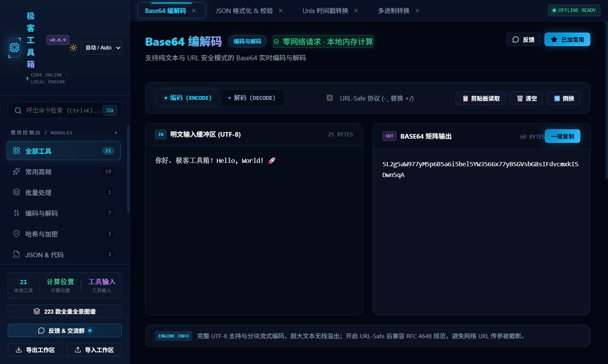
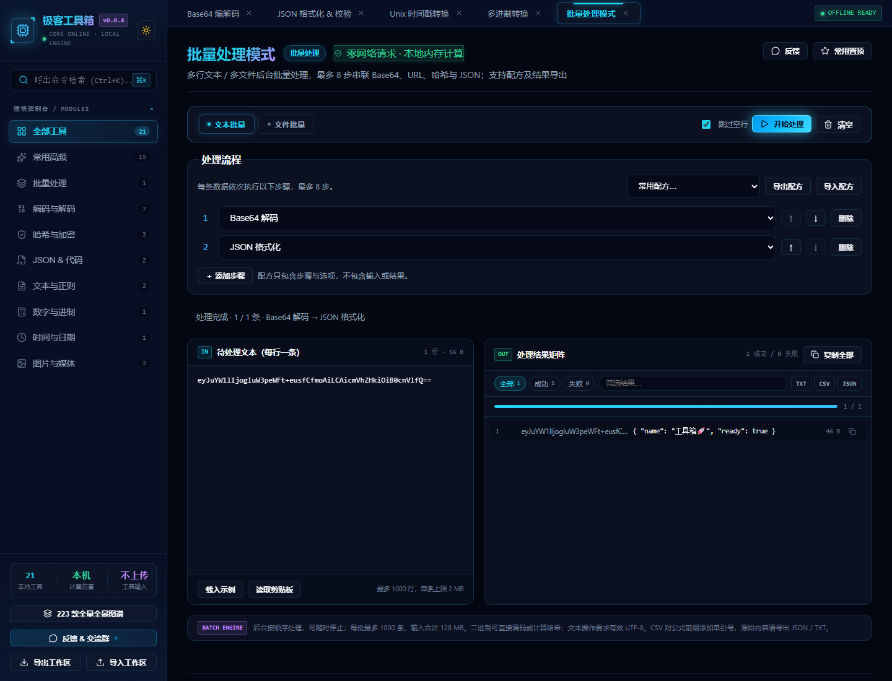

# 极客工具箱（Geek Toolbox）

<p align="center">
  
</p>

[](https://github.com/yuchen0x1/Base64-encode-encoding/actions/workflows/build-all.yml)   

极客工具箱是离线开发者工具集。Windows x64 桌面版使用 Electron、Vue 3 和 Vite，内置 21 款工具。命令行版可在 Windows、Linux 和 macOS 的 Node.js 22+ 环境中复用桌面配方。工具输入在本机处理。

**下载**：[最新 Windows 安装包](https://github.com/yuchen0x1/Base64-encode-encoding/releases/latest) · **仓库**：[GitHub](https://github.com/yuchen0x1/Base64-encode-encoding) · **交流群**：[冷漠网络科技交流群①](https://qm.qq.com/q/bkacrv1t3G)

## 最新更新

<!-- github-release:start -->

**[v0.1.0](https://github.com/yuchen0x1/Base64-encode-encoding/releases/tag/v0.1.0)** · 2026-11-24

本版升级二维码离线识别、JWT HS256 本地验签、JSON 树/路径/差异/类型、颜色多格式转换、全局命令面板与工具懒加载，并加固 Electron IPC、导航和 CSP。

[全部发行记录](https://github.com/yuchen0x1/Base64-encode-encoding/releases)

<!-- github-release:end -->

从 v0.0.4 / v0.0.5 升级时，请先手动覆盖安装 v0.0.7 一次，无需卸载或删除用户配置。
若 v0.0.8 启动后空白，请直接下载 v0.0.9 安装包覆盖安装。

[完整更新历史](docs/releases/release-notes.md) · [更新故障复盘](docs/UPDATER_INCIDENT_2026-11-13.md) · [批量处理指南](docs/BATCH_PROCESSING.md)



## 平台与安装

| 能力 | Windows x64 桌面 | Windows / Linux / macOS 命令行 |
|---|---|---|
| 安装 / 运行 | 下载 `GeekToolbox-Setup-<版本>.exe` 并安装 | 下载 `GeekToolbox-CLI-<版本>.mjs`，用 Node.js 22+ 执行 |
| 21 款交互式工具、收藏、主题、标签和工作区 | 支持 | — |
| Base64、URL、哈希和 JSON 的配方 | 多行文本、多文件、后台运行和结果导出 | 单个文件或标准输入，结果写入标准输出 |
| 版本检查 | 应用内检查、下载和覆盖安装 | `--check-update` 查询版本和摘要，手动替换文件 |

在发布页下载后，可用 `gh release verify-asset v0.1.0 <文件>` 验证 GitHub 的发布证明，或用 `SHA256SUMS.txt` 核对文件摘要。[命令行使用说明](docs/CLI.md) · [平台兼容性与路线图](docs/PLATFORMS.md)

## 功能

### 21 款内置工具

元数据定义于 `src/config/tools.js`，组件注册于 `src/config/registry.js`。

| # | 工具 | id | 分类 | 能力摘要 | 状态 |
|---|---|---|---|---|---|
| 1 | 批量处理模式 | `batch-processor` | 批量 | 文本 / 文件后台批处理、最多 8 步配方、流程导入导出、停止、分页与 TXT / CSV / JSON 导出 | 已实现 |
| 2 | Base64 编解码 | `base64` | 编码 | 文本与 URL 安全模式的实时编解码 | 已实现 |
| 3 | JWT 令牌解析 & 时效诊断 | `jwt-decoder` | 编码 | Header / Payload 解析、时效检查与显式 HS256 本地验签 | 已实现（仅解析模式不证明签名有效） |
| 4 | Unicode & HTML 实体互转 | `unicode-codec` | 编码 | `\uXXXX` 转义与 HTML 字符实体编解码 | 已实现 |
| 5 | 全系 Base 族与黑客密码 | `cipher-toolbox` | 编码 | Hex、Base32、摩斯电码、ROT13 互转 | 已实现 |
| 6 | 图片与 Base64 互转 | `image-base64` | 媒体 | 本地图片转 DataURL，Base64 还原预览与下载 | 已实现 |
| 7 | URL 编解码 | `url-codec` | 编码 | `encodeURI` / `encodeURIComponent` 两种模式 | 已实现 |
| 8 | JSON 格式化 & 校验 | `json-format` | JSON | 高亮、美化、压缩、转义与错误定位 | 已实现 |
| 9 | 摘要哈希计算 | `hash-crypto` | 加密 | MD5、SHA-1、SHA-256、SHA-512、HMAC | 已实现（基于 `crypto-js`） |
| 10 | AES 对称加解密 | `aes-crypto` | 加密 | CBC / ECB 模式、多种填充与密钥 IV | 已实现（开发调试用途） |
| 11 | Unix 时间戳转换 | `timestamp` | 时间 | 秒 / 毫秒时间戳与北京时间互转 | 已实现 |
| 12 | 正则表达式测试器 | `regex-tester` | 文本 | 常用正则、匹配测试、捕获组提取与高亮 | 已实现（Worker 隔离，超时终止） |
| 13 | 文本代码对比 | `text-diff` | 文本 | 逐行差异高亮（基于 `diff`） | 已实现 |
| 14 | 多进制转换 | `radix-convert` | 进制 | 二 / 八 / 十 / 十六进制实时互转 | 已实现 |
| 15 | 二维码生成与识别 | `qrcode-generator` | 媒体 | 生成二维码、离线本地图片识别、容错率调整、PNG 导出与结果导出 | 已实现（识别使用内联 ZXing WASM） |
| 16 | 随机密码 & UUID | `random-password` | 加密 | 强密码、随机串、UUID v4、批量生成 | 已实现 |
| 17 | 文本去重 & 统计 | `text-toolbox` | 文本 | 行去重、转小写、字数 / 行数统计、空行清除 | 已实现 |
| 18 | JWT 生成器 | `jwt-generator` | 编码 | 自定义 Header / Payload，注入 `iat` / `exp`，HS256 签名 | 已实现 |
| 19 | 颜色格式转换 | `color-converter` | 媒体 | HEX/RGB/RGBA/HSL/HSLA/HSV/HSVA 双向输入、Alpha 与历史记录 | 已实现 |
| 20 | 转义字符工具 | `escape-toolbox` | 编码 | C 风格、`\uXXXX`、`\x41` 转义与还原 | 已实现 |
| 21 | SQL 格式化 | `sql-formatter` | JSON | SQL 美化与压缩，**仅处理文本，不连接数据库** | 已实现 |

> 工具能力依据组件和相关逻辑模块核实。JWT “仅解析”模式不验签；HS256 验签仅证明使用用户提供密钥的本地签名匹配。二维码识别不上传图片、不访问 CDN。

### 工作区与批量处理

- 深浅主题、工具搜索、分类筛选、收藏、多标签，以及工作区 JSON 导入导出。
- 全局命令面板（Ctrl/Cmd+K）、快捷键帮助、最近使用记录和收藏/最近优先排序。
- 用户偏好保存在 Electron 用户目录中的 localStorage，键为 `geek-toolbox-state`；不自动保存工具输入。
- 批量处理支持文本 / 文件、1–8 步有序配方、后台 Worker、停止、分页和 TXT / CSV / JSON 导出。
- 每批最多 1000 条；文本每条 2 MiB、文件每个 64 MiB、输入合计 128 MiB。详细限制见[批量处理指南](docs/BATCH_PROCESSING.md)。
- `toolhelper_directory.json` 的 223 项是第三方工具静态目录，不代表本项目实现了 223 款工具。
- 响应式布局适应 Windows 窗口大小变化，不作为其他平台的产品版本。



## 安装与使用

下载 `GeekToolbox-Setup-<版本>.exe`，按向导选择安装位置。启动后可搜索工具、收藏或打开多个标签。

应用启动约 4 秒后检查更新，也可点击侧边栏版本号手动检查。下载完成后，点击「立即安装并重启」。`version.json` 是自动更新清单，无需普通用户手动下载。

历史版本 v0.0.7 的安装包未签名。最新包的签名状态见[当版发行说明](https://github.com/yuchen0x1/Base64-encode-encoding/releases/latest)。关于安装更新故障和已有验收边界，见[故障复盘](docs/UPDATER_INCIDENT_2026-11-13.md)。

## 开发与构建

在 Windows 上安装 Node.js 22 或更高版本：

```sh
npm ci
npm run electron:dev
```

也可双击 `启动工具箱.bat` 或 `运行PC桌面版.bat`，二者均从当前源码构建并打开 Electron 桌面窗口。

| 命令 | 用途 |
|---|---|
| `npm run dev` | 仅用于渲染界面的本地开发预览，不是独立网页产品 |
| `npm run build` | 生成 Electron 使用的 `dist/` 界面资源 |
| `npm run electron:dev` | 构建界面并打开 Windows 桌面窗口 |
| `npm run build:win` | 生成 `release/win-unpacked/` 开发检查目录 |
| `npm run package:win` | 生成 Windows x64 NSIS 安装包 |
| `npm run release` | 本地构建安装包、校验完整性并生成更新清单 |
| `npm run release:desktop` | 与 `npm run release` 相同，保留既有命令兼容性 |
| `npm test` | 单元与集成检查 |
| `npm run lint` | 源码检查 |
| `npm run test:desktop` | Electron 沙箱界面与后台 Worker 冒烟检查 |
| `npm run test:updater` | 独立更新助手启动与失败保护检查，不执行安装 |
| `npm run clean -- --dry` | 预览可再生成的构建产物与缓存 |

打包需要 electron-builder 的 Windows 工具链；发布前的归档校验需要 7-Zip，可通过 `TOOLBOX_7Z` 指定 `7z.exe`。

## Windows 发布与更新

本地发布脚本只生成：

```text
updates/desktop/version.json
updates/desktop/GeekToolbox-Setup-<版本>.exe
```

`npm run release` 只准备本地产物，不会自行上传 GitHub。可以复用已构建安装包：

```sh
npm run release -- --skip-build --installer "release/GeekToolbox-Setup-0.0.7.exe"
```

云同步目录可能干扰大文件写入；可使用 `--out` 将构建输出放到本地磁盘。不要跳过安装包完整性校验。

- `.github/workflows/quality.yml`：在 Windows 上运行测试、lint 和界面构建。
- `.github/workflows/build-all.yml`：仅构建并保存 Windows 安装包。
- `.github/workflows/release.yml`：验证主线版本标签，构建 Windows 安装包和命令行版，上传资产至草稿并校验后发布。

Windows 更新以官方 GitHub Releases 为准。可通过 `TOOLBOX_UPDATE_FEED` 或安装目录的 `update-config.json` 配置匹配官方摘要的备用源。开发环境默认读取 `updates/desktop/`。

下载必须通过 SHA-256 与大小校验；清单配置 Authenticode 指纹时还会验证安装包签名。SHA-256 本身不提供发布者身份认证。独立助手确认就绪后应用才退出，安装后核验目标版本并重新启动。完整配置及证书 Secrets 见[自动更新说明](docs/AUTO_UPDATE.md)。

## 目录与架构

```text
src/                 Vue 桌面界面、21 款工具、Worker、工作区和更新状态
public/              窗口图标和界面 favicon
build/               Windows 安装图标及 NSIS 脚本
electron/            主进程、preload IPC、安装更新器和独立助手
shared/              版本比较与官方 GitHub Release 资产校验
cli/                 独立命令行入口和单文件构建
scripts/             Windows 发布、图标生成、清理和助手验证脚本
tests/               工具逻辑、Windows 更新和渲染界面验证
docs/                使用指南、发布历史和历史审计记录
.github/workflows/   Windows 构建、质量检查与发布
```

`dist/` 是 Electron 的必要渲染资源。Electron 使用 `file://` 加载它，并开启沙箱、上下文隔离和 webSecurity，关闭渲染器 Node 集成。`preload.cjs` 只暴露更新接口，外链交由系统浏览器打开。

网页预览用于开发桌面界面。GitHub Releases 为桌面和命令行版提供版本及下载资产。

## 验证与已知边界

修改后按[贡献指南](CONTRIBUTING.md)执行适当检查。自动化构建不等于真实安装、代码签名或客户端完整自动升级验收；每次交付应分别记录结果。

[维护与发布](docs/MAINTENANCE.md) · [竞品研究](docs/ECOSYSTEM_RESEARCH.md) · [安全问题私密报告](SECURITY.md)

当前 `npm run lint` 为 0 error、0 warning。JWT 的解析模式不校验签名；二维码识别使用本地 WASM；颜色工具支持多种格式和 Alpha。敏感数据处理和大输入性能边界详见对应工具说明。

历史审计文档记录的是当时的版本与范围，其中的平台、服务器和 ZIP 更新描述不再代表当前产品。不要按历史报告恢复已移除的运行形态。

## 图标与许可

源图为 `assets/icon-source.jpg`。安装 Pillow 后运行 `python scripts/generate-icons.py`，只生成 Windows 安装 / 窗口图标和界面 favicon，再运行 `npm run build` 同步资源。

项目采用 [MIT License](LICENSE)。依赖包括 Vue、Vite、Electron、crypto-js、qrcode、zxing-wasm、diff、lucide、Vitest 和 ESLint；各依赖遵循自身许可证。

## Star History 星图

项目在 GitHub 上的 Star 增长趋势，点击图表可查看交互式星标历史。

<a href="https://www.star-history.com/?repos=yuchen0x1%2FBase64-encode-encoding&amp;type=date&amp;legend=top-left">
  <picture>
    <source media="(prefers-color-scheme: dark)" srcset="https://api.star-history.com/chart?repos=yuchen0x1/Base64-encode-encoding&amp;type=date&amp;theme=dark&amp;legend=top-left" />
    <source media="(prefers-color-scheme: light)" srcset="https://api.star-history.com/chart?repos=yuchen0x1/Base64-encode-encoding&amp;type=date&amp;legend=top-left" />
    
  </picture>
</a>
