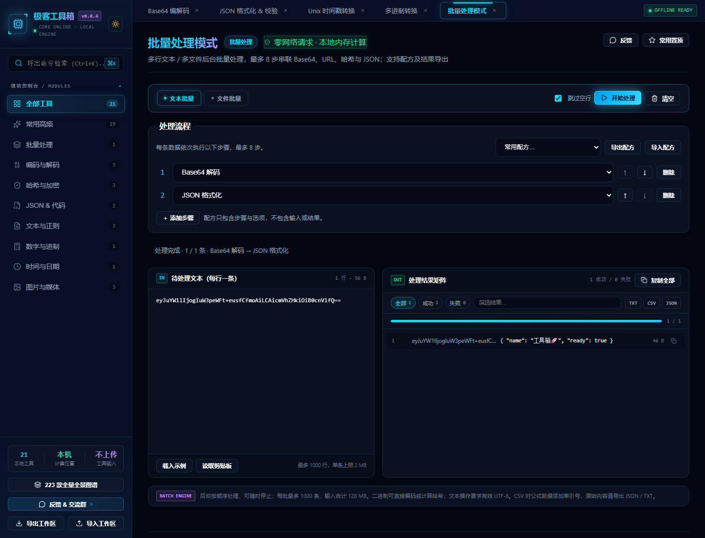
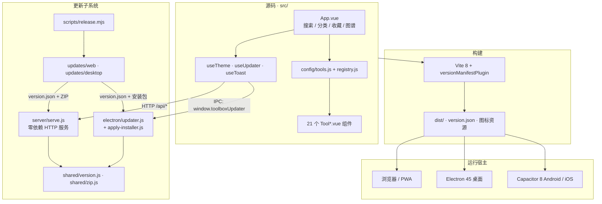
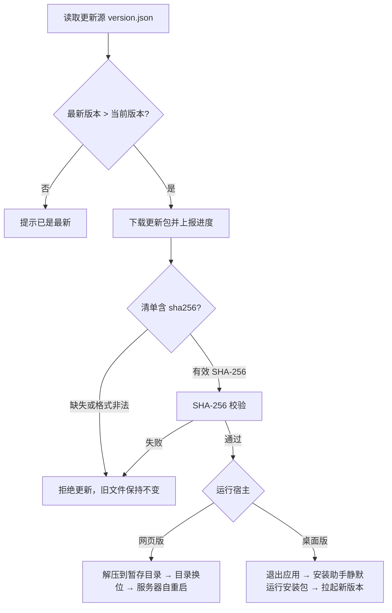

# 极客工具箱（Geek Toolbox）

<p align="center">
  
</p>

[](https://github.com/yuchen0x1/Base64-encode-encoding/actions/workflows/build-all.yml)    

**仓库**：<https://github.com/yuchen0x1/Base64-encode-encoding> · **下载**：[v0.0.6 Windows 安装包](https://github.com/yuchen0x1/Base64-encode-encoding/releases/tag/v0.0.6)

**交流群**：<https://qm.qq.com/q/bkacrv1t3G> · 点击链接直接加入 QQ 群「**冷漠网络科技交流群①**」（问题反馈 / 功能建议 / 版本更新通知）。App 内也可通过侧边栏底部「反馈 & 交流群」、工具标题栏「反馈」按钮或移动端顶栏消息图标打开加群弹窗（支持二维码扫码与复制链接）。

> 一个**本地优先、零后端依赖**的跨端开发者工具箱：内置 21 款开箱即用的编解码 / 哈希 / 格式化工具，可运行于浏览器、Electron 桌面端与 Capacitor 移动容器，并自带网页版与桌面版的一键更新链路。

## 最新更新

### v0.0.6（2026-11-13）

- 修复安装更新后退出、没有重新打开的问题，补齐独立更新助手必需的启动数据。
- 助手确认就绪后才退出当前应用；启动失败会显示错误并保留旧程序。
- **已安装 v0.0.4 / v0.0.5 的用户，请手动覆盖安装 v0.0.6 一次。** 不需要卸载或删除用户配置；之后的更新使用修复后的流程。

[完整更新历史](docs/releases/release-notes.md) · [更新故障复盘](docs/UPDATER_INCIDENT_2026-11-13.md) · [批量流程指南](docs/BATCH_PROCESSING.md)

> **关于工具数量（请先读这一条）**
> 项目实际内置 **21 款可运行工具**（`src/config/tools.js` 与 `src/config/registry.js` 一一对应，并有单元测试强制校验）。`toolhelper_directory.json` 中的 **223 项**分属 30 个分类，是「工具矩阵图谱」的静态目录数据，**仅用于展示与检索，第三方链接不在本项目内实现**。早期 `public/manifest.json` 中「187 款小工具」为过期表述，已更正。

## 目录

- [1. 项目简介](#1-项目简介)
- [2. 核心功能](#2-核心功能)
- [3. 技术架构](#3-技术架构)
- [4. 项目目录结构](#4-项目目录结构)
- [5. 环境要求](#5-环境要求)
- [6. 安装部署](#6-安装部署)
- [7. 配置说明](#7-配置说明)
- [8. 使用指南](#8-使用指南)
- [9. API 文档](#9-api-文档)
- [10. 发布与更新源](#10-发布与更新源)
- [11. 图标与品牌资源](#11-图标与品牌资源)
- [12. 常见问题 FAQ](#12-常见问题-faq)
- [13. 开发指南](#13-开发指南)
- [14. 安全说明](#14-安全说明)
- [15. 许可证与致谢](#15-许可证与致谢)
- [16. Star History 星图](#16-star-history-星图)

---

## 1. 项目简介

### 解决什么问题

开发者日常会遇到大量零散的一次性处理需求：解一段 Base64、算个哈希、格式化一段 JSON、对一下时间戳、比两份文本的差异。常见做法是把内容贴到在线工具站——但这意味着**数据离开本机**，在离线环境、内网环境或处理敏感文本时都不可接受。

极客工具箱把这些操作收进一个可离线运行的本地应用：所有计算在浏览器标签页或桌面进程内完成，不依赖服务端、不上传输入内容。

### 核心定位与适用场景

| 维度 | 说明 |
|---|---|
| 定位 | 本地优先（local-first）的纯前端工具集合 + 一套自研的离线更新机制 |
| 主要场景 | 离线 / 内网开发、敏感文本处理、日常编解码与格式校验、多端一致的工具入口 |
| 适合用户 | 前端 / 后端 / 运维开发者、需要离线工具的学生与技术支持人员 |
| 运行形态 | 静态网页与 PWA、Windows / macOS 桌面应用、Android / iOS 容器应用 |
| 数据存储 | 仅 `localStorage` 保存界面偏好；无数据库、无账号、无云同步 |

### 不适合做什么（避免误解）

- **不是**密码学审计或密钥管理工具：AES / JWT 等能力用于开发调试，不替代专业安全产品。
- **不是**在线 SaaS：没有用户系统、服务端业务接口或数据持久化后端。
- **不是** 223 个工具的实现集合：工具矩阵图谱只是静态目录。
- 移动端是 Capacitor 容器包装的 Web 应用，不是原生重写，且未在本次审查中做真机验证。

---

## 2. 核心功能

### 2.1 21 款内置工具

工具元数据定义于 `src/config/tools.js`，组件实现注册于 `src/config/registry.js`。分类视图包含 8 个业务分类（批量 / 编码 / 加密 / JSON / 文本 / 进制 / 时间 / 媒体）以及「全部工具」「常用高频」两个聚合视图。

| # | 工具 | id | 分类 | 能力摘要 | 状态 |
|---|---|---|---|---|---|
| 1 | 批量处理模式 | `batch-processor` | 批量 | 文本 / 文件后台批处理、最多 8 步配方、流程导入导出、停止、分页与 TXT / CSV / JSON 导出 | 已实现 |
| 2 | Base64 编解码 | `base64` | 编码 | 文本与 URL 安全模式的实时编解码 | 已实现 |
| 3 | JWT 令牌解析 & 时效诊断 | `jwt-decoder` | 编码 | Header / Payload 解析，`iat` / `nbf` / `exp` 时效检查 | 部分实现（仅解析，**不校验签名**） |
| 4 | Unicode & HTML 实体互转 | `unicode-codec` | 编码 | `\uXXXX` 转义与 HTML 字符实体编解码 | 已实现 |
| 5 | 全系 Base 族与黑客密码 | `cipher-toolbox` | 编码 | Hex、Base32、摩斯电码、ROT13 互转 | 已实现 |
| 6 | 图片与 Base64 互转 | `image-base64` | 媒体 | 本地图片转 DataURL，Base64 还原预览与下载 | 已实现 |
| 7 | URL 编解码 | `url-codec` | 编码 | `encodeURI` / `encodeURIComponent` 两种模式 | 已实现 |
| 8 | JSON 格式化 & 校验 | `json-format` | JSON | 高亮、美化、压缩、转义与错误定位 | 已实现 |
| 9 | 摘要哈希计算 | `hash-crypto` | 加密 | MD5、SHA-1、SHA-256、SHA-512、HMAC | 已实现（基于 `crypto-js`） |
| 10 | AES 对称加解密 | `aes-crypto` | 加密 | CBC / ECB 模式、多种填充与密钥 IV | 已实现（开发调试用途） |
| 11 | Unix 时间戳转换 | `timestamp` | 时间 | 秒 / 毫秒时间戳与北京时间互转 | 已实现 |
| 12 | 正则表达式测试器 | `regex-tester` | 文本 | 常用正则、匹配测试、捕获组提取与高亮 | 已实现（Worker 隔离，超时终止） |
| 13 | 文本代码对比 | `text-diff` | 文本 | 逐行差异高亮（基于 `diff`） | 已实现 |
| 14 | 多进制转换 | `radix-convert` | 进制 | 二 / 八 / 十 / 十六进制实时互转 | 已实现 |
| 15 | 二维码生成器 | `qrcode-generator` | 媒体 | 生成二维码、容错率调整、PNG 导出、容量错误提示 | 已实现（仅生成，不含二维码解析） |
| 16 | 随机密码 & UUID | `random-password` | 加密 | 强密码、随机串、UUID v4、批量生成 | 已实现 |
| 17 | 文本去重 & 统计 | `text-toolbox` | 文本 | 行去重、转小写、字数 / 行数统计、空行清除 | 已实现 |
| 18 | JWT 生成器 | `jwt-generator` | 编码 | 自定义 Header / Payload，注入 `iat` / `exp`，HS256 签名 | 已实现 |
| 19 | 颜色格式转换 | `color-converter` | 媒体 | HEX 输入 / 取色，输出 RGB、RGBA、HSL、HSLA；Alpha 固定为 1 | 已实现（不含 RGB/HSL 反向输入） |
| 20 | 转义字符工具 | `escape-toolbox` | 编码 | C 风格、`\uXXXX`、`\x41` 转义与还原 | 已实现 |
| 21 | SQL 格式化 | `sql-formatter` | JSON | SQL 美化与压缩，**仅处理文本，不连接数据库** | 已实现 |

> 工具能力依据组件和相关逻辑模块核实。JWT 解析不验签；二维码工具只生成，不提供识别功能。

### 2.2 工具矩阵图谱（静态目录）

`toolhelper_directory.json` 收录 **30 个分类、223 个条目**（形如 `{ "name": ..., "url": "/JSON/JSONFormat?type=1" }`），由 `src/App.vue` 导入后以图谱 / 弹窗形式展示。这些 URL 是第三方站点的相对路径，**指向的项目不在本仓库内**，可用性未经验证，点击行为不等于调用本项目功能。

### 2.3 主题与个性化

- 深色 / 浅色主题，默认深色；`index.html` 在首帧前同步预应用主题类，避免闪烁。
- 界面状态保存在 `localStorage` 的 `geek-toolbox-state`，包含 `isDark`、`favorites`、`openTabs`、`currentToolId`。
- 侧边栏支持导出 / 导入版本化工作区 JSON，迁移收藏、标签页、当前工具和主题；导入时按当前注册表过滤未知工具。
- 支持工具搜索、分类筛选、收藏、多标签打开；收藏默认值见 `src/App.vue`。
- 响应式布局适配桌面与移动端。

### 2.4 批量处理

`ToolBatch.vue` 支持多行文本与多文件拖拽，可将 Base64 / URL 编解码、MD5 / SHA-1 / SHA-256、JSON 格式化与压缩串成 **1–8 步流程**。例如选择「Base64 解码 → JSON 格式化」，一次处理多条编码后的 JSON，无需逐条复制。可增删步骤、上下调整顺序、导入 / 导出配方；配方仅包含处理选项，不包含输入或结果。

运算在专用 Web Worker 中执行，支持立即停止并保留已完成结果。单批最多 1000 条；文本每行最多 2 MB，文件每个最多 64 MB，输入总计最多 128 MB；结果按 100 条分页。二进制解码后可继续哈希或重新编码，文本输出要求有效 UTF-8，损坏字节会明确报错。

结果可筛选、复制及导出 TXT / CSV / JSON。CSV 带 UTF-8 BOM，并为潜在公式添加单引号；需要逐字保留原始内容时请用 JSON / TXT。JSON 导出记录实际运行的配方、完成状态和条目数量。完整限制、文件格式及使用示例见 [批量流程指南](docs/BATCH_PROCESSING.md)。



### 2.5 跨端运行与自动更新

| 能力 | 说明 |
|---|---|
| 浏览器 / PWA | `dist/` 静态托管；`manifest.json` 提供安装图标；`server/serve.js` 可附加更新接口 |
| Electron 桌面 | 主进程 + `preload.cjs` 最小桥接，启动 4 秒后自动检查一次更新 |
| Capacitor 移动 | Android / iOS 原生工程包装 `dist/`，通过 `npx cap sync` 同步 |
| 网页版更新 | 本地服务器下载更新包 → SHA-256 校验 → 替换 `dist/` → 进程自重启 |
| 桌面版更新 | 下载 → SHA-256 校验 → 解压 → 独立替换进程覆盖 `app.asar` / 完整程序 → 重启应用 |

### 2.6 实现状态与边界

| 项目 | 状态 |
|---|---|
| 21 款工具、主题、搜索、收藏、批量处理、工作区备份 | 已实现 |
| 网页版 / 桌面版检查、下载、校验、替换、重启 | 已实现（服务端 / 主进程内） |
| 二维码解析、JWT 验签 | 未实现 |
| 账号体系、数据库、缓存、消息队列、云同步 | 未使用，项目亦不依赖 |
| 组件 / DOM 交互自动化测试 | 已补充浏览器 smoke 验证；Vitest 仍运行于纯 Node 环境 |
| iOS / macOS / Android 真机验证 | 未在本次审查中验证（见 [PROJECT_AUDIT_REPORT.md](PROJECT_AUDIT_REPORT.md) 第 8 节） |

---

## 3. 技术架构

### 3.1 技术栈

仅列出项目实际使用的技术，版本取自 `package.json`。

| 层次 | 技术 | 版本 / 说明 |
|---|---|---|
| 语言 | JavaScript（ESM）、Vue SFC、Node.js | 服务端与主进程均为原生 ESM |
| 前端框架 | Vue 3 | `^3.5.44`，Composition API + `<script setup>` |
| 构建 | Vite + `@vitejs/plugin-vue` | `^8.3.6` / `^6.0.10` |
| 桌面 | Electron + electron-builder | `^45.2.3` / `^26.18.0` |
| 移动 | Capacitor（core / cli / android / ios） | `^8.6.0` |
| 工具依赖 | `crypto-js`、`qrcode`、`diff` | `^4.2.0` / `^1.5.4` / `^9.0.0` |
| 图标 | `lucide-vue-next` | `^0.577.0`（置于 devDependencies） |
| 应用图标生成 | Python 3 + Pillow | 仅 `scripts/generate-icons.py` 使用 |
| 本地服务器 | Node.js 内置 `http` / `crypto` / `zlib` | 零第三方依赖 |
| ZIP | 自研 `shared/zip.js` | 零依赖，支持 stored / deflate、CRC 校验、路径穿越防护 |
| 测试 | Vitest | `^5.1.0`，`node` 环境 |
| 代码检查 | ESLint + eslint-plugin-vue | `^10.14.0` / `^10.12.0`，flat config |
| CI | GitHub Actions | `.github/workflows/build-all.yml`，4 个平台 job |
| 数据库 / 缓存 / 消息队列 | 无 | — |

### 3.2 系统架构图



### 3.3 运行机制与数据流

1. **构建期**：`vite.config.js` 读取 `package.json` 与 `release-notes.json`，注入编译期常量 `__APP_VERSION__` / `__BUILD_TIME__` / `__RELEASE_NOTES__` / `__RELEASE_DATE__`，并由 `versionManifestPlugin` 产出 `dist/version.json`（字段：`version`、`buildTime`、`channel`、`releaseDate`、`notes`）。开发服务器通过中间件提供同一份 `/version.json`，保证各模式口径一致。
2. **首屏**：`index.html` 的内联脚本从 `geek-toolbox-state` 读取 `isDark`，在 Vue 挂载前设置 `<html>` 的 `dark` / `light` 类与 `colorScheme`；`useTheme.js` 随后接管响应式主题。
3. **工具调用**：`App.vue` 依据 `tools.js` 的元数据渲染分类与搜索，通过 `registry.js` 的 `toolComponents` 动态挂载对应组件。`assertToolRegistry()` 在开发期校验元数据与组件一一对应。所有计算在组件内完成，输入不经过网络。
4. **状态持久化**：仅 `localStorage`，无 Pinia / Vuex，无 `vue-router`（页面切换由 `currentToolId` 等 ref 驱动）。
5. **配置加载**：项目不使用 `.env`。网页服务器配置来自 CLI 参数与环境变量（优先级：`PORT` / `HOST` / `TOOLBOX_WEB_ROOT` / `TOOLBOX_WEB_FEED` 覆盖 CLI）；桌面更新源优先级为 `TOOLBOX_UPDATE_FEED` → `update-config.json` 的 `feed` → 打包版默认 GitHub Releases `latest/download/version.json`；开发环境默认读取项目根 `updates/desktop/`。桌面端的更新载体就是 NSIS 安装包本身：下载 → 校验 → 静默覆盖安装 → 自动重启。
6. **异常处理**：静态服务做路径穿越与真实路径校验；网页版更新失败时恢复完整旧目录，桌面版更新由独立安装助手处理并核验预期版本；ZIP 解压拒绝 `..` 条目与目标目录外写入，并限制解压资源占用。

### 3.4 更新流程



> 网页版与桌面版更新均强制校验有效的 `sha256`；清单缺失或格式非法会拒绝应用更新，摘要不匹配也会中止更新并保持旧版本。发布脚本 `scripts/release.mjs` 会写入摘要。

---

## 4. 项目目录结构

```text
极客工具箱/
├── index.html                  HTML 入口：CSP、主题预应用、favicon / manifest 引用
├── package.json                脚本、依赖、electron-builder 配置（appId / icon / targets）
├── package-lock.json
├── vite.config.js              Vite 配置、版本清单插件、编译期常量
├── vitest.config.js            测试配置（node 环境）
├── eslint.config.js            ESLint flat config
├── capacitor.config.json       appId / appName / webDir
├── release-notes.json          按版本存放更新说明（构建期注入 version.json）
├── toolhelper_directory.json   工具矩阵图谱静态目录（30 类 / 223 项，非功能实现）
│
├── src/                        Vue 3 前端
│   ├── main.js                 应用挂载、注册表自检、开发期版本日志
│   ├── App.vue                 主界面、搜索 / 收藏 / 标签 / 图谱 / 状态持久化
│   ├── assets/base.css         全局样式与 CSS 主题变量
│   ├── config/
│   │   ├── tools.js            21 款工具元数据与 10 个分类视图
│   │   └── registry.js         id → 组件映射 + assertToolRegistry()
│   ├── components/
│   │   ├── ToastContainer.vue  全局提示
│   │   ├── UpdateModal.vue     更新说明与进度弹窗
│   │   └── tools/              21 个工具组件（Tool*.vue）
│   ├── composables/
│   │   ├── useTheme.js         响应式主题
│   │   ├── useUpdater.js       双模式更新状态机（HTTP / IPC）
│   │   └── useToast.js         提示队列
│   └── utils/htmlEntities.js   HTML 实体解码
│
├── public/                     Vite 原样复制到 dist/ 的静态资源
│   ├── manifest.json           PWA 清单（含 any / maskable 图标）
│   ├── favicon.ico             多尺寸网站图标
│   ├── favicon-32.png
│   ├── icon-192.png / icon-512.png                 PWA 图标（透明背景）
│   ├── icon-maskable-192.png / icon-maskable-512.png  掩码图标（不透明）
│   └── apple-touch-icon.png
│
├── assets/                     图标源图 icon-source.jpg（生成脚本输入）
├── build/                      electron-builder 图标：icon.ico / icon.png / icon-1024.png
├── scripts/
│   ├── release.mjs             发布脚本（网页包 / 桌面完整包 / 增量包）
│   └── generate-icons.py       全平台图标生成器（Python + Pillow）
│
├── server/serve.js             零依赖静态服务器 + 网页版更新 API
├── electron/
│   ├── main.js                 主进程、窗口、安全策略
│   ├── preload.cjs             contextBridge 暴露 window.toolboxUpdater
│   ├── updater.js              桌面端检查 / 下载 / 校验 / 安装
│   └── apply-installer.js      安装助手（退出后静默安装并拉起）
├── shared/
│   ├── version.js              语义化版本解析与比较
│   └── zip.js                  零依赖 ZIP 读写与解压防护
├── tests/                      21 个 Vitest 测试文件（131 个用例）
├── android/ ios/               Capacitor 原生工程（含各密度图标与启动图）
├── .github/workflows/          build-all.yml（macOS / iOS / Android / Windows）
│
├── 启动工具箱.bat              Windows：npm run dev
├── 启动网页版.bat              Windows：构建后启动 server/serve.js
├── 运行PC桌面版.bat            Windows：启动 release/win-unpacked/极客工具箱.exe
│
├── LICENSE / CONTRIBUTING.md / PROJECT_AUDIT_REPORT.md
└── dist/ release/ updates/     构建与发布产物，.gitignore 已排除
```

> `dist/`、`release/`、`updates/`、`.tmp-verify/`、`.tmp-release/`、`dist-win/`、`release-build/` 均为本地产物，不入库。

---

## 5. 环境要求

| 项目 | 要求 | 依据 / 备注 |
|---|---|---|
| 操作系统（开发） | Windows / macOS / Linux | 纯 Node + Vite，无平台专属依赖 |
| Node.js | **建议 20.x** | `.github/workflows/build-all.yml` 与构建脚本均使用 20；`启动网页版.bat` 提示 18+，**口径不一致** |
| npm | 随 Node.js 提供 | CI 使用 `npm ci`，本地可用 `npm install` |
| 数据库 / 缓存 / 消息队列 | 无 | 项目不使用 |
| 必需的外部服务 | 无 | 仅在「检查更新」时需要可访问的更新源；工具本身完全离线 |
| Python 3 + Pillow | 仅重新生成图标时需要 | `scripts/generate-icons.py`，非运行依赖 |
| Windows 桌面打包 | Windows + npm 依赖 | `electron-builder --win` |
| macOS 桌面 / iOS 打包 | macOS + Xcode | CI 的 `build-macos` / `build-ios` job |
| Android 打包 | JDK 21 + Android SDK | CI 使用 `temurin` 21 与 `gradlew assembleDebug` |
| 浏览器 | 支持 ES Module 与现代 CSS 的现代浏览器 | 使用了 `crypto-js`、`fetch`、CSS 变量 |

> **版本口径说明**：`package.json` 未声明 `engines`，仓库无 `.nvmrc`，因此 Node.js 的**最低可用版本未经 package.json engines 约束**。代码使用了全局 `fetch`（Node 18+ 提供），Capacitor 8 CLI 要求 Node.js 22+，项目统一按 Node 22 开发与构建。

---

## 6. 安装部署

以下命令均在**项目根目录**（包含 `package.json` 的目录）执行。

### 6.1 获取项目与安装依赖

```bash
git clone https://github.com/yuchen0x1/Base64-encode-encoding.git
cd Base64-encode-encoding
npm install          # 或按 CI 使用 npm ci（需要 package-lock.json）
```

仓库地址取自本项目的 `git remote origin`。若只需使用桌面版，可在 [Releases](https://github.com/yuchen0x1/Base64-encode-encoding/releases/tag/v0.0.6) 下载 v0.0.6 Windows 安装包（`GeekToolbox-Setup-<版本>.exe`，每个版本仅此一个文件），无需安装 Node.js。

项目**不需要 `.env` 文件**，也不需要数据库初始化或密钥配置。

### 6.2 本地开发

```bash
npm run dev
```

开发服务器固定监听 `http://127.0.0.1:5173/`（`vite.config.js` 的 `server.host` / `server.port`）。Windows 可双击 `启动工具箱.bat`。

### 6.3 生产构建

```bash
npm run build
```

产物输出到 `dist/`，其中包含 `index.html`、`version.json`、PWA 清单、图标与打包后的 JS / CSS。`vite.config.js` 使用 `base: './'`，因此 `dist/` 可用于 Electron、`file://` 及子路径静态托管。

### 6.4 启动带更新能力的网页版服务器

```bash
npm run serve:build          # 等价于 vite build && node server/serve.js
# 已有 dist/ 时也可直接：
npm run serve
```

默认地址 `http://127.0.0.1:4173/`，静态根目录 `dist/`，更新源 `updates/web`。Windows 可双击 `启动网页版.bat`（等价于 `node server/serve.js --root dist --feed updates/web`）。

### 6.5 启动 / 打包 Electron 桌面版

```bash
npm run electron:dev         # vite build && electron .
npm run build:win            # vite build && electron-builder --win --x64 --dir
npm run package:win          # 生成唯一的 Windows 安装包到 release/
```

`运行PC桌面版.bat` 直接启动 `release/win-unpacked/极客工具箱.exe`，**需先执行 `npm run build:win` 或 `npm run package:win`**。

> **构建目录不要放在云同步盘里（重要）**
> 本仓库位于云同步目录时，第三方同步客户端会在 100 MB 级安装包落盘过程中介入（上传、去重、回写），
> 可能把 `app-64.7z` 的数据区写坏：安装包仍能「安装成功」并返回 0，但装出来的目录只有 dll/pak、
> 没有主程序与 `app.asar`，桌面快捷方式随即指向不存在的文件。
> 构建时请把输出指到本地磁盘，例如 `node scripts/release.mjs --version x.y.z --desktop --out E:/geek-build`，
> 发布脚本会先用 7-Zip 校验 `app-64.7z` 的 CRC，损坏则直接中止发布（需要安装 7-Zip 或设置 `TOOLBOX_7Z`）。

### 6.6 移动端（Capacitor）

```bash
npm run build
npx cap sync android         # 或 npx cap sync ios
```

随后用 Android Studio / Xcode 打开 `android/` / `ios/App` 工程构建。`capacitor.config.json` 指定 `webDir: "dist"`。CI 中 Android 使用 `./gradlew assembleDebug`（未签名 debug APK），iOS 使用 `xcodebuild ... CODE_SIGNING_ALLOWED=NO build`。

### 6.7 验证运行状态

```bash
# 网页版服务器
curl http://127.0.0.1:4173/api/version
# 期望：{"version":"0.0.4","buildTime":"...","mode":"server"}

# 开发服务器（version.json 由 Vite 中间件提供）
curl http://127.0.0.1:5173/version.json

# 前端构建与静态检查
npm test
npm run lint
```

另可在浏览器打开页面，检查顶部版本号是否显示 `v0.0.4`、深浅色切换是否正常、任意工具能否完成一次计算。

---

## 7. 配置说明

项目无集中式配置文件，配置分散在命令行参数、环境变量与几个 JSON 中。以下均为**代码中真实存在**的项。

### 7.1 网页服务器（`server/serve.js`）

| 配置名 | 作用 | 是否必需 | 默认值 |
|---|---|---|---|
| `--port <n>` | 监听端口 | 否 | `4173` |
| `--host <addr>` | 监听地址 | 否 | `127.0.0.1` |
| `--root <dir>` | 静态资源根目录 | 否 | `./dist` |
| `--feed <dir\|url>` | 更新源目录或 URL | 否 | `./updates/web` |
| `--allow-remote-update` | 允许非回环地址触发更新 | 否 | 关闭（仅本机） |
| `-h` / `--help` | 打印用法并退出 | 否 | — |
| `PORT` | 覆盖端口（优先于 `--port`） | 否 | — |
| `HOST` | 覆盖监听地址（优先于 `--host`） | 否 | — |
| `TOOLBOX_WEB_ROOT` | 覆盖静态根目录 | 否 | — |
| `TOOLBOX_WEB_FEED` | 覆盖更新源 | 否 | — |
| `TOOLBOX_ALLOW_REMOTE_UPDATE` | 值为 `1` 时允许远程更新 | 否 | 未设置 |
| `TOOLBOX_RESTARTED` | 内部使用，标记自重启后的进程 | 否 | 由 `scheduleRestart()` 设置 |

### 7.2 桌面端更新（`electron/updater.js`）

| 配置名 | 作用 | 是否必需 | 默认值 |
|---|---|---|---|
| `TOOLBOX_UPDATE_FEED` | 更新源目录或 `version.json` URL（最高优先级） | 否 | 未设置 |
| `update-config.json` 的 `feed` | 更新源（打包版位于 exe 同目录，开发版位于项目根） | 否 | 不存在则跳过 |
| GitHub Releases `latest/download/version.json` | 打包版默认更新清单 | 否 | 未配置自定义源时使用 |
| 项目根 `updates/desktop/` | 开发模式兜底更新源 | 否 | 仅未打包开发环境使用 |
| `TOOLBOX_APP_DIR` | 指定待替换的应用目录，用于开发模式测试安装流程 | 否 | 打包时取 exe 所在目录 |
| `ELECTRON_RUN_AS_NODE` | 内部使用，`apply-installer.js` 以纯 Node 方式运行 | 否 | 由替换流程设置 |

### 7.3 发布脚本（`scripts/release.mjs`）

| 参数 | 作用 | 默认值 |
|---|---|---|
| `--version <x.y.z>` | 指定发布版本号 | `package.json` 当前版本 |
| `--bump <patch\|minor\|major>` | 自动递增版本号 | — |
| `--desktop` | 额外生成桌面完整包（`electron-builder --dir`） | 关闭 |
| `--desktop` | 额外构建 Windows 安装包并写入 `updates/desktop/` | 关闭 |
| `--skip-build` | 复用已有 `dist/`，跳过 `vite build` | 关闭 |
| `--notes "a\|b\|c"` | 覆盖 `release-notes.json` 中的更新说明 | 读取 `release-notes.json` |
| `--out <dir>` | 指定 electron-builder 输出目录 | `release` |
| `-h` / `--help` | 打印用法 | — |

### 7.4 构建期常量与前端配置

| 配置名 | 作用 | 来源 | 可否手动修改 |
|---|---|---|---|
| `__APP_VERSION__` | 应用版本号 | `vite.config.js` 的 `define` | 通过 `package.json` 的 `version` 间接修改 |
| `__BUILD_TIME__` | 构建时间（ISO 字符串） | 同上 | 构建时自动生成 |
| `dist/version.json` | 当前部署版本的唯一事实来源 | `versionManifestPlugin` | 不手改，由构建生成 |
| `geek-toolbox-state` | `localStorage` key（主题 / 收藏 / 标签 / 当前工具） | `src/App.vue` | 运行时由应用维护 |
| `capacitor.config.json` | `appId` / `appName` / `webDir` | 项目根 | 可改 |
| `build.icon` / `win.icon` | electron-builder 图标路径 | `package.json` | 可改 |

---

## 8. 使用指南

### 8.1 基本使用流程

1. 打开应用（浏览器、桌面窗口或移动端）。
2. 在左侧 / 顶部搜索框输入关键词（工具名、中文别名或 tag）或从分类中选择工具。
3. 在工具面板输入内容，结果区实时更新；点击复制按钮取走结果。
4. 收藏常用工具，或打开多个工具标签并行处理。
5. 通过右上角的主题按钮切换深浅色，状态会自动保存。

> 所有输入仅在当前标签页 / 桌面进程内处理，不会上传。

### 8.2 常见操作示例

```bash
# 批量处理：拖入多个文件 → 选择「SHA-256 摘要」→ 导出 CSV
# 结果 CSV 带 UTF-8 BOM，可直接用 Excel 打开

# 检查网页版更新（服务器模式下）
curl http://127.0.0.1:4173/api/update/check

# 手动触发更新（默认仅允许本机）
curl -X POST http://127.0.0.1:4173/api/update/apply
curl http://127.0.0.1:4173/api/update/progress
```

桌面端更新由启动 4 秒后的自动检查触发，也可在更新弹窗中手动执行「检查 → 下载 → 安装」。

### 8.3 npm scripts 速查

| 命令 | 实际作用 |
|---|---|
| `npm run dev` | `vite` 开发服务器（127.0.0.1:5173） |
| `npm run build` | `vite build` → `dist/` |
| `npm run preview` | `vite preview` 预览构建产物 |
| `npm run serve` | `node server/serve.js`（需已有 `dist/`） |
| `npm run serve:build` | 先构建再启动服务器（4173） |
| `npm run release` | `node scripts/release.mjs`（网页更新包） |
| `npm run release:desktop` | `node scripts/release.mjs --desktop` |
| `npm run electron:dev` | `vite build && electron .` |
| `npm run build:win` | Windows 目录版打包（`--dir`） |
| `npm run package:win` | Windows NSIS 安装包（唯一发布产物） |
| `npm test` | `vitest run`（逻辑与回归测试） |
| `npm run test:watch` | `vitest` 监听模式 |
| `npm run test:desktop` | 构建并在隐藏的 Electron 沙箱窗口验证 `file://` 下的批量 Worker（不会安装应用） |
| `npm run lint` / `npm run lint:fix` | ESLint 检查 / 自动修复 |
| `npm run clean` | 清理构建产物与临时目录（`--dry` 预览，`--all` 连依赖一起清） |

---

## 9. API 文档

本项目**没有对外业务 API**。`server/serve.js` 提供的是网页版本地更新接口，Electron 侧是进程内 IPC。全部接口均为真实实现。

### 9.1 本地 HTTP 接口（`server/serve.js`，默认 `127.0.0.1:4173`）

| 接口 | 方法 | 参数 | 返回 | 说明 |
|---|---|---|---|---|
| `/api/version` | GET | 无 | `{ version, buildTime, mode: "server" }` | 读取 `ROOT/version.json`；缺失时 `version` 为 `"0.0.0"` |
| `/api/update/check` | GET | 无 | `{ mode, supported, hasUpdate, currentVersion, latest \| null }` | 读取更新源并比较版本；读取失败返回 `502` 且 `hasUpdate: false` |
| `/api/update/apply` | POST | 无请求体 | `202 { jobId, status }` | 异步启动更新任务 |
| `/api/update/progress` | GET | 无 | 任务状态对象 | 前端轮询进度 |
| `/version.json` | GET | 无 | 构建期版本清单 | 静态文件；开发模式由 Vite 中间件提供 |
| 其它 `/api/*` | — | — | `404 { error: "未知 API" }` | — |

`latest` 字段（存在新版本时）：`{ version, buildTime, notes[], size, force }`。
进度对象字段：`{ id, status, percent, message, error, fromVersion, toVersion, startedAt, finishedAt }`，`status` 依次为 `idle → preparing → downloading → verifying → extracting → swapping → restarting → done`，失败为 `error`。

**状态码与鉴权**

| 场景 | 状态码 |
|---|---|
| `/api/update/apply` 非 POST | `405` |
| 已有更新任务进行中 | `409` |
| 非回环地址且未启用 `--allow-remote-update` | `403` |
| 更新源无法读取（check） | `502` |
| 静态资源路径穿越 | `403` |
| 静态资源不存在 | `404` |

无 Token / 账号体系；唯一的「鉴权」是基于来源 IP 的回环地址检查。

**示例**

```bash
curl http://127.0.0.1:4173/api/version
# {"version":"0.0.4","buildTime":"...","mode":"server"}

curl http://127.0.0.1:4173/api/update/check
# {"mode":"server","supported":true,"hasUpdate":false,"currentVersion":"0.0.4","latest":null}

curl -X POST http://127.0.0.1:4173/api/update/apply
# {"jobId":"1731...","status":"preparing"}

curl http://127.0.0.1:4173/api/update/progress
# {"id":"...","status":"downloading","percent":35,"message":"正在下载更新包… 46%", ...}
```

### 9.2 Electron IPC（`electron/preload.cjs` / `updater.js`）

渲染进程通过 `window.toolboxUpdater` 调用，主进程 `ipcMain.handle` 注册。

| Channel | 调用 | 返回 |
|---|---|---|
| `update:info` | `getInfo()` | `{ mode, currentVersion, packaged, feed, appDir, platform }` |
| `update:check` | `check()` | `{ supported, hasUpdate, currentVersion, latest, mode, packaged, appDir }` |
| `update:download` | `download()` | `{ ok, size, installer, signature }`；下载安装包、断点重试并校验 SHA-256 / 可选 Authenticode |
| `update:install` | `install()` | `{ ok, restarting }`；退出应用后由安装助手静默安装 |
| `update:event` | `onEvent(listener)` | 事件：`{ type: "progress", percent, message }`、`{ type: "available", currentVersion, latest }` |

`onEvent()` 返回取消订阅函数。`preload.cjs` 只暴露上述最小 API，渲染进程始终运行在 `contextIsolation + sandbox` 下。

### 9.3 更新清单 `version.json`

项目中有 4 类同名文件，用途不同，勿混淆：

| 位置 | 生成者 | 主要字段 |
|---|---|---|
| `dist/version.json` | `vite.config.js` | `version, buildTime, channel, releaseDate, notes[]` |
| `updates/web/version.json` | `scripts/release.mjs` | 上述字段 + `package: { url, sha256, size }`，`url` 指向网页 ZIP |
| `updates/desktop/version.json` | `scripts/release.mjs` | 上述字段 + `package.url` 指向 `GeekToolbox-Setup-<version>.exe`，`kind: "nsis"`，可选 `package.signature` |

---

## 10. 发布与更新源

### 10.1 生成更新包

```bash
npm run release                                      # 网页版更新包
node scripts/release.mjs --desktop                   # Windows 安装包 + updates/desktop 更新源
node scripts/release.mjs --version 0.0.4 --desktop
node scripts/release.mjs --bump patch --notes "修复 A|新增 B"
```

产物：

- `updates/web/version.json` + `geek-toolbox-web-<version>.zip`
- `updates/desktop/version.json` + `GeekToolbox-Setup-<version>.exe`

`updates/` 已被 `.gitignore` 排除，需自行上传到 GitHub Release、静态文件服务器或内网共享目录。桌面更新源只需两个文件（`version.json` + 同名安装包），`sha256` 由发布脚本自动写入。GitHub Release 中网页清单使用 `web-version.json`，避免与桌面清单重名。

### 10.2 指向更新源

```bash
# 网页版：目录或 URL 均可
node server/serve.js --root dist --feed updates/web
node server/serve.js --feed https://example.com/updates/web

# 桌面版：环境变量或 update-config.json
#   TOOLBOX_UPDATE_FEED=https://example.com/updates/desktop
#   { "feed": "https://example.com/updates/desktop" }
```

远程 HTTP 更新源以 `/version.json` 为入口；URL 以 `.json` 结尾时直接作为清单读取。

### 10.3 CI

[`quality.yml`](.github/workflows/quality.yml) 在 `main` push、面向 `main` 的 PR 和手动触发时运行测试、lint 与构建。
[`build-all.yml`](.github/workflows/build-all.yml) 在 `main` push、面向 `main` 的 PR 和手动触发时运行 4 个 job：`build-macos`（DMG）、`build-ios`（未签名 Xcode build）、`build-android`（debug APK）、`build-windows`（NSIS 安装包）。所有 job 使用 Node 22；Capacitor 8 的 Android / iOS 同步要求 Node.js 22+。所有 job 均使用 `npm ci`。

[`release.yml`](.github/workflows/release.yml) 只由 `vX.Y.Z` 标签或手动指定标签触发，执行测试、构建、Windows 安装包完整性验证、生成 Web/桌面清单并创建 GitHub Release。普通 push 和 PR 不会发布 Release。

完整的 Secrets、签名、清单、回滚和验收说明见 [`docs/AUTO_UPDATE.md`](docs/AUTO_UPDATE.md)。

> electron-builder 命令已显式使用 `--publish never`，避免在没有 `GH_TOKEN` 时触发隐式发布。Windows 只产出一个 NSIS 安装包，不再产出便携版与独立更新 ZIP。

### 10.4 当前版本（v0.0.4）更新说明

来源：`release-notes.json`，构建期由 `vite.config.js` 注入 `dist/version.json` 的 `notes` 字段。v0.0.4 已发布到 GitHub Releases。

- 修复 Windows 自动更新助手占用安装目录主程序 EXE 导致 NSIS 卸载失败 code 2：改用安装目录外的临时运行时副本启动助手。
- 改进 NSIS 升级兼容性：旧卸载器返回 code 2 时继续执行直接文件清理，并保留安装后版本完整性校验。
- 安装失败时继续自动重试并回退到交互式安装向导，避免留下缺少主程序或 `app.asar` 的半安装目录。

> v0.0.3 的更新校验、网页更新防护和工具边界修复仍包含在本版本中。

---

## 11. 图标与品牌资源

项目已为 Web / PWA、Electron、Android、iOS 提供**统一视觉的应用图标**，主色与界面背景 `#090D16` 保持一致。

| 平台 | 资源 | 规范 |
|---|---|---|
| Web / PWA | `public/favicon.ico`（16–256 多尺寸）、`favicon-32.png`、`icon-192/512.png`、`icon-maskable-192/512.png` | 普通图标透明背景；maskable 不透明且内容收进安全区 |
| Apple Touch | `public/apple-touch-icon.png`（180×180） | 不透明满幅，圆角由系统添加 |
| Electron | `build/icon.ico`（Windows）、`build/icon.png`（512）、`build/icon-1024.png` | `package.json` 的 `build.icon` / `build.win.icon` 引用 |
| Android | `mipmap-*/ic_launcher.png`、`ic_launcher_round.png`、`ic_launcher_foreground.png` | 108dp adaptive 画布，背景色 `#090D16`（`values/ic_launcher_background.xml`） |
| iOS | `Assets.xcassets/AppIcon.appiconset/AppIcon-512@2x.png` | 1024×1024、**RGB 无 alpha**、无自带圆角 |
| 启动画面 | Android `drawable*/splash.png`、iOS `Splash.imageset/*.png` | 深色底 + 居中图标 |

源图存放于 `assets/icon-source.jpg`。需要更换品牌图标时，替换源图后重新生成：

```bash
pip install Pillow
python scripts/generate-icons.py
npm run build        # 将 public/ 下图标同步到 dist/
npx cap sync android # 可选：同步到原生工程
```

生成器用圆角矩形 alpha 蒙版从黑底源图抠出图标，再按平台规范派生透明 / 不透明版本；各平台输出尺寸优先从现有文件读取，避免密度表漂移。

---

## 12. 常见问题 FAQ

**Q：`npm run dev` 后浏览器打不开？**
开发服务器固定 `http://127.0.0.1:5173/`；`4173` 是 `npm run serve` 的网页版服务器端口，两者不同。

**Q：页面版本号显示 `0.0.0` 或无法检查更新？**
说明 `dist/version.json` 不存在。执行 `npm run build` 重新生成（该文件由 Vite 插件产出，不要手改）。

**Q：远程调用 `/api/update/apply` 返回 403？**
默认仅允许回环地址触发更新。启动时加 `--allow-remote-update`，或设置 `TOOLBOX_ALLOW_REMOTE_UPDATE=1`；仅在可信网络内启用。

**Q：更新提示「更新包校验失败」？**
`version.json` 中 `package.sha256` 与下载内容不一致或缺失时，更新会被拒绝、旧文件保持不变。请重新下载或检查更新源清单。

**Q：Windows 上更新替换失败？**
`serve.js` 在目录 rename 报 `EPERM` 时自动降级为逐文件覆盖，并在失败时回滚 `index.html` / `version.json`。若仍失败，检查杀毒软件 / 索引服务是否占用 `dist/`，以及旧进程是否已释放端口（内置 12 次端口重试）。

**Q：Electron 开发模式点「安装更新」报错？**
`installUpdate()` 在开发模式拒绝执行替换，需使用打包后的程序，或设置 `TOOLBOX_APP_DIR` 指向可替换的安装目录。

**Q：新增工具后构建 / 运行报错「工具注册表不一致」？**
必须同时修改 `src/config/tools.js`（元数据）与 `src/config/registry.js`（组件映射）。`assertToolRegistry()` 与 `tests/registry.test.js` 会双向校验；测试还断言工具数量为 21，新增工具时需同步更新该期望值。

**Q：在哪里反馈问题或加入交流群？**
加群链接：<https://qm.qq.com/q/bkacrv1t3G>（冷漠网络科技交流群①）。App 内入口有三处：侧边栏底部「反馈 & 交流群」按钮、工具标题栏右侧「反馈」按钮、移动端顶栏消息图标；弹窗内提供二维码扫码、一键加群与复制链接三种方式（配置集中在 `src/config/social.js`）。需要留痕的缺陷也可以在 [GitHub Issues](https://github.com/yuchen0x1/Base64-encode-encoding/issues) 提交。

**Q：PWA 图标仍是旧图 / 不显示？**
`public/` 下的资源需要 `npm run build` 才会进入 `dist/`。修改图标后请重新构建，并清理浏览器 PWA 缓存。

**Q：移动端图标没变？**
生成图标后还需 `npx cap sync android`（或 `ios`）并重新构建原生工程。

**Q：`运行PC桌面版.bat` 一闪而过？**
该脚本直接启动 `release/win-unpacked/极客工具箱.exe`，不做存在性检查。请先执行 `npm run build:win`。

**Q：`启动网页版.bat` 双击后命令行一闪而过？**
脚本用 `where node` 检查 Node.js，未安装时会 `pause` 提示；若通过非双击方式调用，注意 `启动工具箱.bat` 未切换工作目录，需先 `cd` 到项目根目录。

**Q：Node.js 到底要 18 还是 20？**
README 与 CI 使用 20，`启动网页版.bat` 的提示文案是 18+。项目未声明 `engines`，最低版本未实测，建议统一按 20 使用。

**Q：二维码工具能解析图片吗？**
不能。当前仅实现生成与 PNG 导出，依赖中没有二维码解码库。

**Q：JWT 工具能验证签名吗？**
`jwt-decoder` 仅解析 Header / Payload 并做时效诊断，不校验签名；`jwt-generator` 可生成 HS256 签名令牌。

**Q：为什么有「21 款」「223 项」「187 款」三种说法？**
21 款是本仓库实际实现的工具；223 项是工具矩阵图谱的静态外部目录；187 是早期 PWA 描述中的过期数字，已更正。

**Q：iOS / macOS 构建失败？**
这两个平台需要 macOS + Xcode，Windows 本机无法完整构建。CI 中 iOS 使用 `CODE_SIGNING_ALLOWED=NO` 仅产出未签名 build，不会生成可分发 IPA。

---

## 13. 开发指南

### 13.1 开发环境与检查

```bash
npm install
npm run dev
npm test             # Vitest，131 个用例，node 环境
npm run lint         # ESLint（src / electron / server / shared / scripts / tests）
npm run build        # 生产构建
```

提交前建议按 [CONTRIBUTING.md](CONTRIBUTING.md) 执行 `npm run build`，并在浏览器中检查深浅色两种主题。若修改了更新流程，还需验证：新版本能提示、SHA-256 失败时旧文件不变、更新后能自动重启、更新包路径不能穿越目标目录。

### 13.2 代码规范

- Vue 3 `<script setup>`，工具组件放在 `src/components/tools/`。
- UI 颜色优先使用 `src/assets/base.css` 的 CSS 变量，不在组件里硬编码深色背景。
- 涉及版本信息时同步 `package.json`、`package-lock.json`、`release-notes.json`。
- `eslint.config.js` 关闭了部分与既有紧凑模板风格冲突的格式规则；`vue/no-side-effects-in-computed-properties` 保留为 `warn`（已知技术债，详见 [PROJECT_AUDIT_REPORT.md](PROJECT_AUDIT_REPORT.md)）。
- 提交信息推荐 Conventional Commits 风格。
- 不要提交 `dist/`、`release/`、`updates/`、`.tmp-*`、`.workbuddy/` 等本地产物。
- 不要在工具中上传或记录用户输入。

### 13.3 新增工具的完整步骤

1. 在 `src/components/tools/` 新建 `ToolXxx.vue`。
2. 在 `src/config/tools.js` 的 `toolsList` 添加含 `id` / `name` / `category` / `description` / `tags` / `icon` 的元数据。
3. 在 `src/config/registry.js` 导入组件并加入 `toolComponents`。
4. 更新 `tests/registry.test.js` 中断言的工具数量。
5. 运行 `npm test && npm run lint && npm run build`。

> `assertToolRegistry()` 会在开发期启动自检；只改一处会立即抛出可读错误，而不是运行时静默打不开工具。

### 13.4 测试覆盖范围

| 文件 | 覆盖内容 |
|---|---|
| `tests/version.test.js` | 语义化版本解析、比较、预发布优先级、归一化 |
| `tests/zip.test.js` | CRC32、ZIP 读写往返、二进制、zip-slip 防护、解压边界 |
| `tests/htmlEntities.test.js` | 命名 / 数字实体解码、未知实体、注入载荷不执行 |
| `tests/registry.test.js` | 元数据 ↔ 组件双向一致性、数量断言 |

Vitest 运行于纯 Node 环境；`.tmp-verify/workspace_ui_check.mjs` 使用 Playwright 对开发服务器执行桌面 / 移动 smoke 验证，`vue` 插件用于解析 SFC 导入。

### 13.5 调试提示

- 更新流程日志：网页版写入 `updates/web-update.log`，桌面替换进程写入 `userData/updates/apply.log`。
- 桌面端 `update:info` 会返回实际生效的 `feed` 与 `appDir`，排查更新源时优先查看。
- `vite.config.js` 的 `/version.json` 中间件在 dev / build 两种模式下都可用，便于统一验证版本口径。

---

## 14. 安全说明

| 措施 | 实现位置 |
|---|---|
| 本地优先，输入不上传 | 所有工具组件均在浏览器 / 渲染进程内计算；无遥测与日志上报 |
| 内容安全策略 | `index.html` 的 CSP：`default-src 'self'`、`connect-src 'self' https:`、`font-src 'self' data:` |
| 桌面进程隔离 | `electron/main.js`：`contextIsolation: true`、`sandbox: true`、`nodeIntegration: false`、`webSecurity: true`；`preload.cjs` 仅暴露更新 API |
| 外部链接拦截 | 主进程 `setWindowOpenHandler` / `will-navigate` 拒绝应用内跳转，改用系统浏览器打开 |
| 更新包完整性 | 网页版 `serve.js`、桌面版 `updater.js` 均校验 `sha256`；不一致即中止 |
| 解压防护 | `shared/zip.js` 拒绝 `..` 条目与目标目录外写入，并校验 CRC / 大小 |
| 静态服务防护 | `serve.js` 对解析后的路径做根目录前缀校验 |
| 远程更新默认关闭 | `/api/update/apply` 仅回环地址可用，需显式启用远程开关 |
| 更新失败回滚 | 网页版回滚入口文件；目录占用时降级逐文件覆盖 |

**风险与边界（请务必知悉）**

- 若自行构造的更新清单缺少 `package.sha256` 或格式非法，更新会被**拒绝**，旧版本保持不变。务必使用 `scripts/release.mjs` 生成清单，并把更新源托管在可信位置。
- `--allow-remote-update` / `TOOLBOX_ALLOW_REMOTE_UPDATE=1` 会让同一网络内的其他机器触发更新替换，仅限可信网络使用。
- 项目无密钥、Token、`.env` 或账号体系；不要为了部署便利把更新源指向不可信的第三方地址。
- AES、JWT、哈希工具面向开发调试：JWT 解析不验签、AES 使用 `crypto-js`，不用于生产环境的密钥管理或安全审计。
- `PROJECT_AUDIT_REPORT.md` 记录了已知技术债（含 `computed` 副作用告警），可按该报告继续治理。

---

## 15. 许可证与致谢

本项目采用 [MIT License](LICENSE)，版权归 `Copyright (c) 2026 yuchen0x1` 所有。

`package.json` 的 `author` 字段为 `GeekToolBox`，与 LICENSE 中的版权人写法不同，属于待统一的元数据，统一方案见审计报告的「待维护者确认事项」。

**第三方开源项目**：[Vue 3](https://vuejs.org/)、[Vite](https://vite.dev/)、[Electron](https://www.electronjs.org/)、[Capacitor](https://capacitorjs.com/)、[crypto-js](https://github.com/brix/crypto-js)、[qrcode](https://github.com/soldair/node-qrcode)、[diff](https://github.com/kpdecker/jsdiff)、[lucide](https://lucide.dev/)、[Vitest](https://vitest.dev/)、[ESLint](https://eslint.org/)、[Pillow](https://python-pillow.github.io/)（仅图标生成）。各依赖遵循其自身许可证。

贡献流程与约定见 [CONTRIBUTING.md](CONTRIBUTING.md)，历史审计结论见 [PROJECT_AUDIT_REPORT.md](PROJECT_AUDIT_REPORT.md)。应用图标源图由项目维护者提供。

审查范围、实测验证结果与待维护者确认事项统一记录在 [PROJECT_AUDIT_REPORT.md](PROJECT_AUDIT_REPORT.md) 中，本文档不再重复。

---

## 16. Star History 星图

项目在 GitHub 上的 Star 增长趋势，点击图表可查看交互式星标历史。

<a href="https://www.star-history.com/?repos=yuchen0x1%2FBase64-encode-encoding&amp;type=date&amp;legend=top-left">
  <picture>
    <source media="(prefers-color-scheme: dark)" srcset="https://api.star-history.com/chart?repos=yuchen0x1/Base64-encode-encoding&amp;type=date&amp;theme=dark&amp;legend=top-left" />
    <source media="(prefers-color-scheme: light)" srcset="https://api.star-history.com/chart?repos=yuchen0x1/Base64-encode-encoding&amp;type=date&amp;legend=top-left" />
    
  </picture>
</a>
