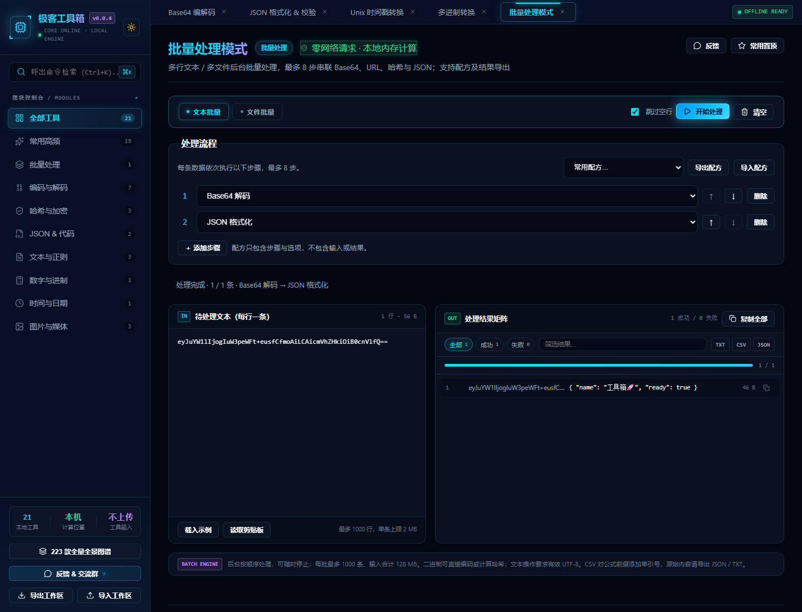
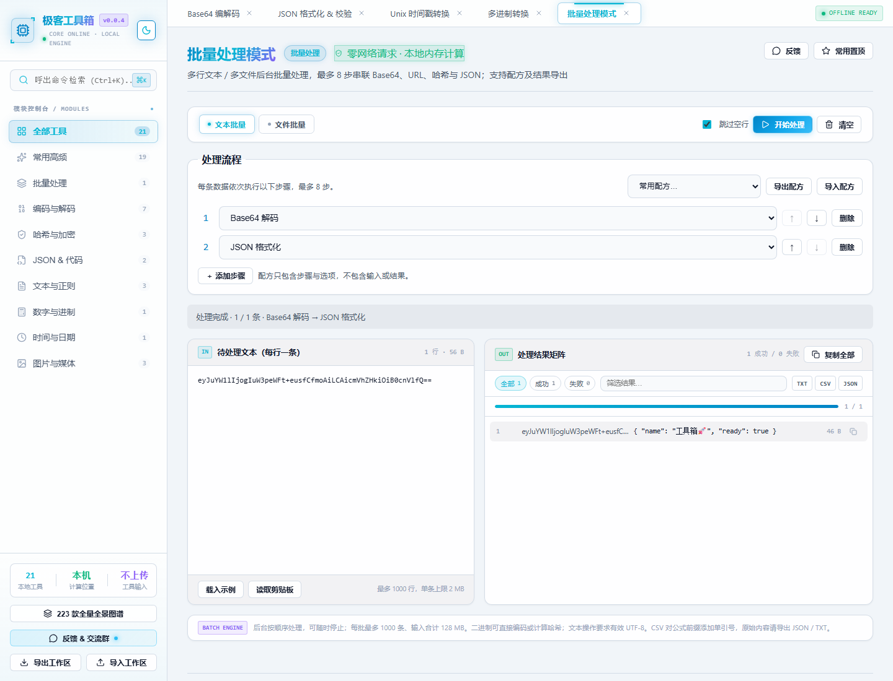

# 极客工具箱：项目调查、开源研究与升级验收

日期：2026-11-13（Asia/Shanghai）。工作目录：`C:\Users\lenmo\Desktop\Base64 encode encoding`。

基线：`main`，HEAD `126d12e`，应用版本 0.0.4。开始时已存在未跟踪的 `.evolution/`，本轮没有覆盖这些历史记录。只修改当前项目；没有提交、推送、创建远程分支、发布、修改账户或安装替换现有应用。

## 执行清单

- [x] 识别项目与 Git 基线，阅读开发规范、重要代码、说明和测试。
- [x] 建立功能地图，识别数据、交互及维护问题。
- [x] 联网搜索，并核查 5 个相关项目的 README、源码与许可证。
- [x] 按收益 / 风险选择可兼容实现的任务。
- [x] 实现批量流程、数据修复、导航修复及二维码反馈。
- [x] 运行逻辑回归、lint、构建、生产浏览器和隐藏 Electron 渲染器检查。
- [x] 更新文档、保存真实截图，核对最终差异。
- [ ] 在线依赖漏洞库检查：网络 / 镜像阻塞，未得到有效结果。
- [ ] Android / iOS / macOS 原生验收、安装升级和发布：本轮未执行。

## 1. 项目定位与功能地图

这是面向开发者的本地工具箱，非只有 Base64 的单页工具。技术栈为 Vue 3.5、Vite 8、JavaScript ESM，使用 CryptoJS、qrcode、diff；Electron 45 提供桌面容器，Capacitor 8 提供移动项目。无业务数据库、账号、云同步和工具计算后端。Node 内置模块组成静态 / 更新服务。

| 层 / 模块 | 源码位置 | 已有能力与边界 |
|---|---|---|
| 入口与工作台 | `src/main.js`、`src/App.vue` | 搜索、分类、收藏、多标签、KeepAlive、静态图谱、反馈与更新入口 |
| 元数据与注册 | `src/config/tools.js`、`registry.js` | 21 个实际组件，与工具列表交叉校验；图谱 223 个目录条目不算内置功能 |
| 编解码（7 款） | Base64、JWT、Unicode、Cipher、URL、JWT Generator、Escape 组件及纯逻辑 | UTF-8 / Base32 / Hex / 实体等；JWT 解析不验签，生成器支持 HS256 |
| 哈希与加密（3 款） | Hash、AES、Password | 文本摘要 / HMAC、AES 调试、随机密码与 UUID；不是生产密钥管理产品 |
| JSON 与代码（2 款） | Json、Sql | JSON 校验 / 排版 / 错误定位；SQL 文本排版，不执行数据库操作 |
| 文本与正则（3 款） | Regex、Diff、TextTools | 正则 Worker 超时、逐行 diff、去重及文本统计；diff 没有独立大文本后台执行器 |
| 数字与时间（2 款） | Radix、Timestamp | BigInt 四进制转换，北京时间与 Unix 时间戳 |
| 媒体（3 款） | ImageBase64、Qrcode、Color | 图片 DataURL、二维码生成、颜色转换；没有二维码识别库 |
| 批量（1 款） | `ToolBatch.vue` | 原为单操作逐条处理；本次增加有序配方与后台执行 |
| 偏好与备份 | `src/utils/appState.js`、`useTheme.js` | localStorage 保存主题、收藏、标签；版本化工作区备份不包含工具输入 |
| 桌面与更新 | `electron/`、`shared/`、`server/`、`scripts/release.mjs` | 隔离渲染器、清单 / SHA-256 / 安装检查、ZIP 资源限制与回滚相关逻辑及测试 |
| 构建与质量 | `package.json`、Vite / Vitest / ESLint、`.github/workflows/` | 开发、静态构建、桌面打包、单元测试及 CI 配置 |

启动：`npm run dev`；构建：`npm run build`；构建产物本地服务：`npm run serve`；桌面运行：`npm run electron:dev`。已有依赖安装完整，`npm ls --depth=0` 通过；没有为本轮重装 node_modules。

本次分析覆盖这些模块的源码、边界和已有测试；不将其称为整个项目的形式化安全证明。仓库有 manifest / 图标，但未发现 Service Worker，不能由此宣称新访客断网首次加载网页已经可用。

## 2. 主要问题与优先级

| 级别 | 问题 / 机会 | 实际影响 | 本轮处理 |
|---|---|---|---|
| P0 | CSV 只转义分隔符，没有公式前缀保护 | 输入、文件名或结果可能在电子表格中被解释为公式 | 对所有单元格引用 / 转义，对危险前缀加单引号；保留 JSON / TXT 原值导出 |
| P1 | 批量 UTF-8 解码使用 `fatal: false` | 非法字节被静默替换，内容已损坏却显示成功 | 字节贯穿流程；仅文本操作严格解码，错误定位到具体步骤 |
| P1 | 导出读取当前可变操作，运行时选项也可修改 | 历史结果的元数据与实际计算可能不一致 | 固定运行快照、运行期间锁定编辑、修改流程后提示旧结果 |
| P1 | 搜索 / 分类结果只有一个时隐藏导航 | 精确搜索后目标反而打不开 | 渲染单个结果，增加无结果状态和重置 |
| P1 | 多工具之间重复复制粘贴 | 批量解码后格式化 / 哈希需要多轮人工操作 | 最多 8 步流程及可移植配方 |
| P2 | 批量同步运算，停止只能等待当前条目完成 | 大文件时界面可能阻塞；停止后进度仍强制 100% | 可复用 Worker、可终止当前条目、真实完成数 |
| P2 | 文件数量 / 批次总量未限制，结果全量渲染 | 大批量内存和 DOM 压力 | 批次 / 结果限制、100 条分页与展开预览截断 |
| P2 | QR 容量失败只写 console | 有输入却空白，缺少恢复指引 | 加载 / 错误提示、修改内容可恢复，下载状态同步 |
| P2 | QR 名称声称解析，HUD 固定延迟和百分比 | 能力与指标表达缺少实际依据 | 正名为二维码生成器，显示本机计算与输入不上传 |

高价值 P1 任务难度中等，沿用已有 Vue / CryptoJS 栈；新增 3 个纯职责模块，没有引入运行依赖或变更 API。主要风险是字节与文本语义、终止竞态和旧结果误标，分别用原生哈希对照、生命周期测试和下载内容验收覆盖。

## 3. 开源竞品研究

通过联网搜索定位项目，再使用 GitHub 只读接口核查 README、相关源码、许可证和仓库维护元数据。下列 5 个仓库均未归档；`pushed_at` 只作为活动线索，不等同于项目质量保证。未运行第三方仓库代码。

| 项目 | 核查的具体实现 | 借鉴与取舍 | 许可证 / 活动线索 |
|---|---|---|---|
| [CyberChef](https://github.com/gchq/CyberChef) | [Recipe.mjs](https://github.com/gchq/CyberChef/blob/master/src/core/Recipe.mjs)、核心 / Worker 目录、README | 有序操作配置与执行器分层；落地轻量配方，不照搬大规模操作系统 | [Apache-2.0](https://github.com/gchq/CyberChef/blob/master/LICENSE)，最近 push 日期 2026-11-13 |
| [IT-Tools](https://github.com/CorentinTh/it-tools) | [Base64 文件转换组件](https://github.com/CorentinTh/it-tools/blob/main/src/tools/base64-file-converter/base64-file-converter.vue)、工具 / 校验目录、README | 文件 / 文本边界、显式校验；落地严格 UTF-8 和可见失败，不复制其静默 catch | [GPL-3.0](https://github.com/CorentinTh/it-tools/blob/main/LICENSE)，2026-11-12 |
| [DevToys](https://github.com/DevToys-app/DevToys) | [SmartDetectionService.cs](https://github.com/DevToys-app/DevToys/blob/main/src/app/dev/DevToys.Core/Tools/SmartDetectionService.cs)、API / Tools 目录、README | 后台任务、取消和服务分层；落地 Worker 终止与职责拆分；自动剪贴板检测留待隐私与交互设计 | [MIT](https://github.com/DevToys-app/DevToys/blob/main/LICENSE.md)，2026-09-29 |
| [sharevb/it-tools](https://github.com/sharevb/it-tools) | [Base64 文本组件](https://github.com/sharevb/it-tools/blob/chore/all-my-stuffs/src/tools/base64-string-converter/base64-string-converter.vue)、README | 独立编码选项与验证、可复用状态；落地配置白名单配方，避免把用户输入持久化到 URL / 存储 | [GPL-3.0](https://github.com/sharevb/it-tools/blob/chore/all-my-stuffs/LICENSE)，2026-11-13；与 IT-Tools 同源，单独标明 |
| [DevTools-X](https://github.com/fosslife/devtools-x) | [Base64Text.tsx](https://github.com/fosslife/devtools-x/blob/master/src/Features/base64/Base64Text.tsx)、Features / Tauri 目录、README | 紧凑输入 / 操作 / 输出工作台和统一复制入口；保留现有 Electron，不为了体积换框架；其直接 btoa / atob 不适合作为本项目 UTF-8 实现 | [MIT](https://github.com/fosslife/devtools-x/blob/master/LICENSE)，2026-05-29 |

许可证处理：仅借鉴设计思想，本轮新增代码独立编写，没有移植 GPL 或其他竞品源码。MIT 参考可在遵守声明的前提下移植，Apache 参考需要遵守其通知要求；由于未复制代码，本轮不引入这些代码的授权义务。

| 对比维度 | 当前项目原状 | 竞品优秀实践 | 差距 | 已实施 / 建议 |
|---|---|---|---|---|
| 核心功能 | 21 工具，批处理单操作 | CyberChef 有序配方 | 多轮处理反复粘贴 | 8 步本地配方，二进制贯穿 |
| UI 设计 | 已有深浅主题与面板 | DevTools-X 紧凑工作台 | 流程不可视、QR 错误空白 | 顺序编号 / 排序、状态与错误提示 |
| 用户体验 | 搜索、收藏、标签与备份已存在 | IT-Tools 校验与文件入口 | 单结果入口隐藏、乱码假成功 | 单结果可打开、严格报错、键盘入口 |
| 技术架构 | 批量 UI 内含计算与导出 | DevToys 服务分离、CyberChef 执行层 | 状态和业务耦合 | 独立处理器 / Worker / runner |
| 自动化能力 | 单操作批量及多格式导出 | CyberChef 可配置流程 | 处理方案难复用 | 版本化配方文件、三种常用流程 |
| 扩展能力 | 注册表校验已有 | DevToys 扩展 API | 任意插件尚无信任 / 兼容设计 | 保留白名单和配方版本；插件作为长期项 |

额外依据：[OWASP CSV Injection](https://owasp.org/www-community/attacks/CSV_Injection)、[Worker.terminate](https://developer.mozilla.org/en-US/docs/Web/API/Worker/terminate)、[TextDecoder.fatal](https://developer.mozilla.org/en-US/docs/Web/API/TextDecoder/fatal)。

## 4. 本次成果与文件

| 文件 | 变化与目的 |
|---|---|
| `src/utils/batchProcessing.js`（新增） | 操作表、配方格式 / 校验、字节安全运算、CSV 安全单元格、运行结果导出 |
| `src/utils/batchWorker.js`（新增） | 后台运算消息入口，不访问 DOM 或网络 |
| `src/utils/batchRunner.js`（新增） | Worker 复用、ArrayBuffer 转移、15 秒超时、异常重建、终止及旧消息保护 |
| `src/components/tools/ToolBatch.vue` | 增删 / 排序流程、配方文件与预设、运行快照、锁定输入、限制、分页、可见进度和停止 |
| `src/App.vue` | 单结果导航、空状态、键盘卡片、搜索标签、替换无依据指标 |
| `src/components/tools/ToolQrcode.vue` | 生成中 / 错误 / 恢复状态，异步代次保护 |
| `src/config/tools.js` | 批量描述 / 搜索词与二维码真实能力名称 |
| `tests/batchProcessing.test.js`、`tests/batchRunner.test.js`（新增） | 37 项逻辑与生命周期回归，不以字符串存在测试冒充行为验证 |
| `tests/browser/batch_smoke.py`（新增） | 11 组真实浏览器场景及下载内容、布局、工具入口检查 |
| `tests/electron/batch-smoke.cjs`（新增） | 隐藏的生产沙箱渲染器，验证 file:// 下二进制处理 Worker |
| `package.json` | 新增 `test:desktop`，无版本 / 依赖变化 |
| `vite.config.js` | 排除 `.tmp-verify/` 文件监听，避免 Electron 测试缓存数据库的 Windows 文件锁报错 |
| `README.md`、`CHANGELOG.md`、本报告、`docs/BATCH_PROCESSING.md` | 实际能力、格式、限制、测试、竞品与交付说明 |
| `docs/screenshots/`（新增 4 图） | 测试样例的深色桌面 / 平板 / 手机和浅色桌面真实截图 |

没有删除文件，没有数据库迁移；已有工具 ID、工作区状态格式、结果导出的原字段保持兼容。二维码只调整名称，ID 仍为 `qrcode-generator`。新增 JSON 结果字段及其含义见使用指南。

性能措施的证据是后台运算、输入缓冲转移和每页 DOM 数限制；没有进行统一硬件基准测试，不声称某个启动时间或百分比加速。构建产生独立批量 Worker 约 75.24 kB，无新增生产依赖。

## 5. 测试与验收证据

环境：Windows、Node 24.20.0、npm 11.19.0，已有 Python 3.14 / Playwright / Chromium。测试未使用日常浏览器资料。先尝试应用 Browser 插件，但其 browser-service.mjs 缺失；依据可用技能改用独立无头 Playwright。没有安装额外依赖。

| 检查 / 命令 | 状态 | 实际结果 |
|---|---|---|
| 初始 `npm test -- --reporter=dot` | PASS | 21 文件、132 测试 |
| 最终 `npm test -- --reporter=dot` | PASS | 23 文件、169 测试，新增 37 项 |
| `npm run lint` | PASS | 0 errors；仍为原有 10 个 computed 副作用 warnings，未降低规则 |
| `npm ls --depth=0` | PASS | 直接依赖完整，退出码 0 |
| `npm run build` | PASS | Vite 构建，包含独立 Worker 产物 |
| `npm run test:desktop` | PASS | 构建并运行隐藏的 Electron 沙箱窗口；file:// 下 Base64 解码到原始二进制 SHA-256 与 Node 对照一致，退出码 0 |
| 开发监听与桌面测试并行 | PASS | 修复前临时 Chromium 缓存产生 EBUSY；忽略 `.tmp-verify/` 后重新启动 Vite 并运行 Electron 冒烟，无文件锁错误 |
| `python tests/browser/batch_smoke.py --url http://127.0.0.1:4186` | PASS | 对生产静态服务执行 11 组场景，页面 / console error 为 0；Python 使用环境中已有的 3.14 解释器 |
| 深浅主题与响应式 | PASS | 1440×1100、768×1024、390×844；无横向溢出，截图人工查看；浅色截图等待颜色过渡完成 |
| 原有工具回归 | PARTIAL | 21 个入口打开成功；逻辑测试覆盖已有核心，不等于每个工具所有交互与边界均经端到端验证 |
| 超时及故障竞态 | PASS / PARTIAL | 单测验证 worker 模型的超时、旧消息、异常重建、停止；浏览器验证真实停止，未进行每类 15 秒真实故障注入 |
| 首次 lint | FAIL → 已修复 | 控制字符防护正则触发 no-control-regex；添加有原因的单行抑制，最终 lint 0 errors |
| 依赖漏洞扫描 | BLOCKED | npmmirror 安全接口 404 / NOT_IMPLEMENTED；显式 npmjs.org 接口 ECONNRESET。没有有效审计结果，不能宣称零漏洞 |
| 全新 npm ci | 未执行 | 复用已有完整依赖安装；未验证干净机器从网络重新安装 |
| 安装包 / 自动更新安装 / 签名 | 未执行 | 没有生成发布资产、触发更新、替换已安装应用或验证证书；隐藏渲染器检查不等于安装验收 |
| Android / iOS / macOS 真机与原生构建 | 未执行 | 复用 Web 组件，但本轮没有对应原生环境验收 |
| 远程 CI / Release | 未执行 | 没有推送或远程写入 |

浏览器场景具体包含：单结果键盘导航、空搜索恢复、Unicode 多步转换和单条失败隔离、配方导入导出 / 拒绝错误与超大文件 / 排序、历史结果快照、CSV 公式保护、真实二进制及空文件哈希、Base64 二进制哈希、1001 行拒绝、250 行分页 / 搜索、1000 行任务中止与部分结果导出、三种尺寸 / 两种主题、二维码超容量失败与恢复、全部工具入口。

Electron 退出后本机 GPU 进程曾输出 command-buffer 状态诊断，退出码仍为 0，渲染器场景及摘要断言通过；未将其作为图形性能或真实安装的证明。测试脚本 / 浏览器下载及原始结果放在忽略的 `.tmp-verify/`，文档截图仅包含测试数据。

## 6. 后续优先级与收益评估

| 优先级 | 任务 | 收益 / 难度 / 风险 | 本轮为何不实施 |
|---|---|---|---|
| P1 | 在审计接口恢复后复核依赖，发现公告后有针对性升级 | 安全收益高；中等；升级需做兼容回归 | 当前缺少有效漏洞库结果，盲目升级没有证据 |
| P1 | 原生平台与干净安装验收 | 验证跨平台实际运行；中高；涉及设备和安装流程 | 本轮无真机 / macOS 验收，不以 Web 通过替代 |
| P2 | 将其余工具 computed 中的错误副作用拆为纯结果对象 | 降低重渲染及状态耦合；中等；需逐工具兼容测试 | 与本轮批处理边界不同，保留已披露 10 警告 |
| P2 | 为 Diff / 图片操作建立按场景的大输入性能基准 | 定位其他同步热点；中等；需要硬件和输入基线 | 未做无依据的全局性能承诺 |
| P2 | 需要识别二维码时评估独立离线解码器 | 媒体能力扩展；中等；新增依赖 / 图片资源限制 | 当前已如实命名为生成器，不用假入口占位 |
| P3 | 服务工作线程离线缓存与已有更新服务的版本协调 | 浏览器离线重开；高；可能造成旧资源混用 | 需要独立设计缓存失效与升级回滚，避免破坏更新 |
| P3 | 显式粘贴的数据类型建议 / 工具输入传递 | 少切换工具；中等；隐私和输入生命周期需要设计 | 不自动读取剪贴板，不引入不必要的 AI 云服务 |
| P3 | 插件协议与第三方操作 | 扩展能力高；高；执行信任与资源隔离风险 | 当前版本化白名单足够，暂不引入任意执行能力 |

## 7. 完成度评估

以下为本轮证据支持的保守工程评分，满分 5；是范围内验收判断，不是经过独立认证的商业产品分数。

| 维度 | 评分 | 依据与扣分项 |
|---|---|---|
| 功能完整度 | 4/5 | 21 入口、完整配方 / 文件 / 导出链路通过；JWT 验签、二维码识别等未实现能力仍明确列出 |
| UI/UX 成熟度 | 3/5 | 三尺寸两主题、单结果导航、错误恢复通过；全局模态焦点、读屏和全面对比度审计未执行 |
| 代码质量 | 4/5 | 分离纯处理逻辑和后台生命周期，169 回归测试；遗留 10 个 computed 副作用警告 |
| 性能 | 3/5 | 后台处理、缓冲转移、分页和逻辑资源上限；未验证各设备峰值内存或统一基准 |
| 安全性 | 3/5 | CSV 防护、UTF-8 校验、操作白名单、沙箱运行；依赖审计阻塞，发布认证链未验收 |
| 稳定性 | 4/5 | 逻辑 / 浏览器 / Electron 检查通过，取消 / 异常恢复有证据；缺原生全平台与安装回归 |
| 可维护性 | 4/5 | 职责清楚、配方格式 / 测试 / 文档齐备；App.vue 及其余工具仍有历史样式和状态技术债 |
| 扩展性 | 3/5 | 集中操作元数据、版本化配方、已有组件注册校验；没有受控第三方插件协议与配方迁移层 |

本轮选定的 P0 / P1 和直接相关 P2 已完成可执行实现与本地验证。在线漏洞库、真机、安装 / 签名和发布证据仍有明确边界；变更保留为本地可审阅状态。

## 8. 真实运行截图

截图由测试脚本运行本地生产构建生成，输入为固定测试样例。

[平板深色](screenshots/batch-tablet-dark.png) · [手机深色](screenshots/batch-mobile-dark.png)
